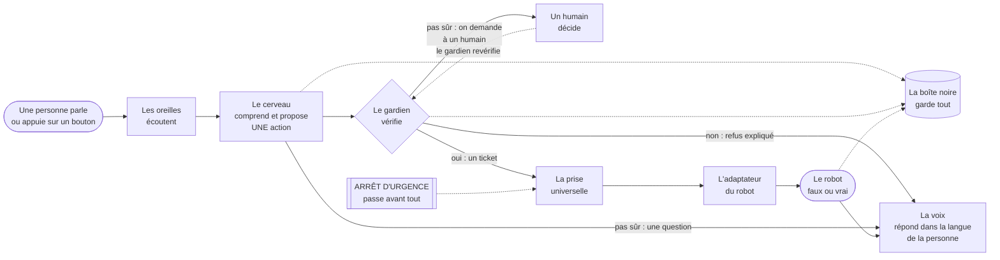

# Leukerbad Robot Carnival — l'ossature du robot et « la clinique en boîte »

> **En une phrase :** une personne parle au robot dans sa langue ; le robot comprend, vérifie que c'est sans danger,
> agit ou demande de l'aide, répond dans la même langue, et tout est gardé en mémoire. Pensé pour marcher avec
> n'importe quel robot (un seul vrai robot essayé à ce jour : une main, le 15.11.2026), et sans Internet.

Projet de l'équipe pour le **Leukerbad Robot Carnival** (14–16 novembre 2026). Responsable : Hiba.

**État honnête, à lire d'abord**

- **Testé sur faux robot, et sur UN vrai robot.** Le 15.11.2026, une main robot (Leadtron DH116) a obéi au système
  entier, par le chemin de sécurité complet. Aucun autre vrai robot n'a reçu d'ordre de ce programme. Un « faux robot » est
  un robot imaginaire, dans l'ordinateur, qui se comporte comme un vrai (il roule, il porte, il tombe en panne).
- **Données inventées.** La clinique, ses patients et ses papiers sont imaginaires. **Pas de médecine** : le robot ne
  donne jamais de diagnostic ni de conseil de santé.
- **Sans Internet.** Tout tourne sur les ordinateurs de l'équipe ; rien ne part sur Internet pendant une démonstration.
- Ce qui n'est pas testé est écrit, ligne par ligne, dans [`NON_TESTE.md`](NON_TESTE.md).

---

## Sommaire

1. [L'idée, sans jargon](#1-lidée-sans-jargon)
2. [Le chemin d'un ordre (l'architecture)](#2-le-chemin-dun-ordre-larchitecture)
3. [Les règles de sécurité](#3-les-règles-de-sécurité)
4. [Les briques, une par une](#4-les-briques-une-par-une)
5. [La clinique en boîte](#5-la-clinique-en-boîte)
6. [Sur quelles machines ça tourne](#6-sur-quelles-machines-ça-tourne)
7. [Essayer (pour l'équipe)](#7-essayer-pour-léquipe)
8. [Ce qui est prouvé, ce qui ne l'est pas](#8-ce-qui-est-prouvé-ce-qui-ne-lest-pas)
9. [Comment le dossier est rangé](#9-comment-le-dossier-est-rangé)
10. [Petit lexique](#10-petit-lexique)

---

## 1. L'idée, sans jargon

Imaginez un robot comme un **nouvel employé** dans un service :

- il **écoute** ce qu'on lui demande, dans plusieurs langues ;
- il **réfléchit** à ce qu'on attend de lui ;
- avant de faire quoi que ce soit, il passe devant un **chef de la sécurité** qui peut dire non ;
- s'il ne comprend pas, il **demande** au lieu de deviner ;
- s'il ne peut pas, il **passe la main à un humain** ;
- et il tient un **carnet de bord** de tout ce qu'il fait, pour qu'on puisse vérifier après.

Le samedi du concours, on ne sait pas encore quel robot on recevra (un humanoïde, un chien, un bras, un robot à
roues…). C'est pourquoi le programme est une **ossature** : un squelette qui marche avec n'importe quel robot. Pour un
nouveau robot, on écrit seulement un petit « traducteur » (l'adaptateur), le reste ne change pas.

---

## 2. Le chemin d'un ordre (l'architecture)

Le mot « architecture » veut dire ici : **qui parle à qui, dans quel ordre.** La règle la plus importante du projet :
**un ordre au robot suit toujours le même chemin, et aucun autre.**

*(Si le dessin ne s'affiche pas, voici la même chose en mots.)*

**Les étapes, une par une :**

1. **Une personne parle** (ou tape, ou appuie sur un bouton de l'écran). Elle peut parler français, allemand,
   italien, anglais ou chinois ; le suisse allemand est compris, et le robot répond alors en allemand.
2. **Les oreilles** transforment la voix en texte. *(Outil : Whisper, sur l'ordinateur, sans Internet. La clinique
   utilise whisper.cpp, essayé sur l'iMac avec une voix de synthèse, pas encore avec un vrai micro.)*
3. **Le cerveau** lit le texte et propose **une seule action** que ce robot sait faire, ou pose **une question** s'il
   n'est pas sûr. Le cerveau ne touche jamais le robot. *(Outil : Apertus, un modèle de langue suisse, qui tourne sur
   l'ordinateur ; en secours, un « cerveau à règles » simple, sans modèle. Dans la clinique, c'est aujourd'hui le
   cerveau à règles qui répond ; Apertus a été mesuré à part, voir les fichiers `MESURE_*.md`.)*
4. **Le gardien** vérifie l'action **avant** qu'elle parte : est-ce que ce robot sait le faire ? est-ce trop
   rapide, trop fort, trop près de quelqu'un, dans une zone interdite ? Il peut dire **oui**, **non** (et le robot
   explique pourquoi, dans la langue de la personne), ou **« un humain doit décider »**. Le gardien ne dépend pas du
   cerveau : même si le cerveau se trompe, le gardien refuse.
5. Si c'est oui, le gardien donne un **ticket** : un bon signé, valable **une seule fois**, pour **cette** action.
6. **La prise universelle** ne laisse passer une action que si elle a son ticket. Elle parle à tous les robots de la
   même façon (dix actions : se déplacer, regarder, écouter, parler, saisir, poser, montrer, rejouer un geste,
   s'arrêter, dire son état).
7. **L'adaptateur** traduit ces dix actions dans la langue de **ce** robot-là (un par marque de robot).
8. **Le robot** agit. Puis **la voix** dit ce qui a été fait, ou pourquoi ce n'est pas fait. *(Outil : la voix du
   Mac ; en chinois, Piper ; pour une langue sans voix, des sous-titres à l'écran.)*
9. **La boîte noire** a tout noté, à chaque étape : on peut relire, compter, et **rejouer** une séance.

**L'arrêt d'urgence passe avant tout** : un « stop » dit à voix haute, ou le bouton ARRÊT de n'importe quel écran,
arrête le robot tout de suite, sans passer par le cerveau.

> Des vérifications automatiques prouvent ce chemin : aucune autre pièce du programme ne peut donner un ordre au
> robot sans passer par le gardien.

---

## 3. Les règles de sécurité

| Règle | Ce que ça veut dire |
|---|---|
| **Un seul chemin** | cerveau → gardien (ticket) → prise → adaptateur → robot. Jamais de raccourci. |
| **L'arrêt d'abord** | « Stop » et le bouton ARRÊT passent avant toute autre chose. Après un arrêt d'urgence, c'est un humain qui réarme. |
| **Lent et doux par défaut** | La vitesse et la force sont limitées dans les réglages (`reglages.yaml`). |
| **Dans le doute, on demande** | Une phrase mal entendue ou ambiguë donne une question, pas une action au hasard. Deux « pas compris » de suite : le robot lève la main et appelle un humain. |
| **Un humain peut prendre la main** | Depuis l'écran de l'équipe, un humain pilote le robot, puis rend la main. Le jury le voit. |
| **Le cerveau ne parle pas tout seul** | Si le cerveau propose de faire dire une phrase au robot sur un ordre, le robot dit à la place une phrase fixe : « Je ne peux pas faire cela. » La règle vise l'action « parler » ; testé sur faux robot avec un faux cerveau. |
| **Pas de médecine** | Démonstration de soin : avec un mannequin seulement, jamais de diagnostic. |
| **Dire vrai** | Chaque résultat est étiqueté : RÉEL, FAUX ROBOT, SIMULÉ ou JOUÉ. Rien de simulé ne se fait passer pour du réel. |
| **Un vrai robot, seulement avec un humain** | Le premier essai sur un vrai robot demande qu'un humain tape une phrase au clavier, et le programme refuse un vrai robot dont le test complet n'a pas réussi. C'est une protection contre l'oubli ; la vraie garde, c'est l'accord de la responsable et du responsable sécurité. |

---

## 4. Les briques, une par une

Le programme est découpé en **briques** : des morceaux indépendants, chacun avec son guide d'une page (`GUIDE.md`)
et sa liste de petites tâches (`TACHES.md`), pour que plusieurs personnes travaillent en même temps.

**État** : *prête* = construite et vérifiée ; *socle* = marche, mais il manque des morceaux ; *pas construite* = le
dossier n'existe pas encore. **Aucune brique n'a été essayée sur un vrai robot.**

| # | Brique | À quoi elle sert, en mots simples | État |
|---|---|---|---|
| 1 | **La prise universelle** | La même « prise » pour tous les robots : dix actions, la carte d'identité du robot (ce qu'il sait faire, ses limites), le ticket. | prête |
| 2 | **Le faux robot** | Un robot imaginaire pour travailler sans matériel. Trois modèles (humanoïde, chien, bras), et des pannes d'entraînement. Des robots à roues existent aussi, dans la clinique seulement. | prête |
| 3 | **Les adaptateurs** | Le traducteur vers un vrai robot. Un assistant prépare le dossier d'un nouveau robot ; un test de conformité vérifie l'adaptateur. | socle |
| 4 | **Les oreilles et la voix** | Comprendre et parler en plusieurs langues, sans Internet. | prête |
| 5 | **Les yeux** | Dire ce que la caméra voit (personnes, objets, marqueurs). Les yeux ne commandent jamais : ils informent le gardien et le cerveau. | socle |
| 6 | **Le cerveau** | Comprendre la demande, choisir une action ou poser une question. Plusieurs cerveaux en cascade : si le grand tombe, un plus petit prend le relais (passage essayé avec un faux serveur seulement). | prête |
| 7 | **Le gardien** | Vérifier chaque action avant qu'elle parte ; seul à donner des tickets. | prête |
| 8 | **« Je ne suis pas sûr »** | Savoir demander de l'aide au bon moment, au lieu de deviner. | prête |
| 9 | La mémoire | (prévue ; dans la clinique, c'est le « carnet » qui garde la mémoire de l'équipe) | pas construite |
| 10 | Apprendre un geste | (prévue) | pas construite |
| 11 | **La main humaine** | Un humain prend la main depuis l'écran, donne des ordres simples, puis la rend. | socle |
| 12 | **La boîte noire et la fiche de vérité** | Tout garder, compter en chiffres vrais, pouvoir tout rejouer. | prête |
| 13 | **L'écran** | L'écran de l'équipe (vue du robot, bouton ARRÊT, journal) et l'écran du jury. | prête |
| 14 | **La porte des agents (MCP)** | Un agent d'IA peut commander le robot comme une personne qui parle, toujours sous le contrôle du gardien. | socle |
| 15 | **Le chef de démonstration** | Jouer une démonstration comme une partition : une liste d'étapes, chacune avec son plan B. | prête |
| 16 | Deux robots | (prévue ; dans la clinique, une flotte de robots est déjà jouée sur faux robot) | pas construite |
| 17 | **Le kit du samedi matin** | Passer du texte du défi à un plan en une heure : il repère les mots-clés, un humain relit. | socle |

La liste exacte, mise à jour avec les commandes de chaque brique : [`briques/etat_des_briques.yaml`](briques/etat_des_briques.yaml).

---

## 5. La clinique en boîte

C'est la **démonstration** construite sur l'ossature : une clinique de réadaptation **en miniature**, où **un seul
cerveau** aide **toute une équipe** et **plusieurs robots**. Tout est joué sur faux robot, avec un faux dossier.

### Ce qu'on y voit : une matinée en sept scènes

| Scène | Ce qui se passe |
|---|---|
| 1. **L'arrivée** | Une patiente arrive. Le robot de l'accueil la salue dans sa langue. |
| 2. **Les papiers** | Pour chaque papier d'arrivée, le programme propose où le ranger ; une personne de l'accueil valide d'un doigt. Rien n'est rangé ni envoyé sans elle. |
| 3. **Le soin** | Le soignant suit sa liste de soin et coche au doigt ou à la voix. Il manque un coussin : un robot va le chercher. |
| 4. **Le soir** | La patiente pose ses questions pour le médecin ; elles arrivent chez lui. |
| 5. **Le médecin, le lendemain** | Le médecin lit un résumé de sa patiente, chaque phrase avec sa source. Il dicte une demande (tapée aujourd'hui), qui devient une tâche pour le thérapeute ; sa note reste un brouillon. |
| 6. **La flotte** | Plusieurs robots ; l'un tombe en panne, un autre reprend sa course. Le tableau dit pourquoi tel robot a été choisi. |
| 7. **La vérité** | La fiche de vérité montre les chiffres de la séance, les bons comme les mauvais, et on peut la rejouer. |

### Les pièces de la clinique

| Pièce | En mots simples |
|---|---|
| **Le faux dossier** | Douze patients inventés, leurs chambres, leurs rendez-vous, trois listes de soin d'exemple. Il ne change jamais. |
| **La porte de lecture** | Chaque personne a un **badge** (soignant, médecin, accueil, direction, patient, robot…). La porte ne montre à chacun que ce qu'il a le droit de voir, et note chaque lecture. Exemple : l'accueil ne voit jamais un texte médical ; la direction ne voit que des nombres, aucun nom. |
| **Le carnet** | Tout ce que l'équipe et les robots font est écrit ici (qui, quand, et si un humain l'a validé). Le faux dossier, lui, n'est jamais modifié. |
| **L'horloge** | Une horloge de démonstration qui peut sauter au soir ou au lendemain matin, et le dit à l'écran. |
| **Les écrans** | Un écran par métier (accueil, soignant, thérapeute, médecin, direction, patient), lisible sur un téléphone ou une tablette du même Wi-Fi. |
| **Les listes de soin** | Cocher un point au doigt ou à la voix ; à la fin du poste, ce qui reste à faire est rappelé. |
| **Les tâches et le robot** | « Il manque un coussin » devient une course pour un robot, vérifiée par le gardien à chaque geste. |
| **Le résumé du médecin** | Un résumé où chaque phrase cite sa source ; une phrase sans source n'est pas montrée. |
| **Les papiers** | Une proposition de rangement pour chaque papier ; une personne valide. |
| **L'accueil** | Le robot du hall accueille, renseigne et appelle un humain s'il le faut. |
| **La flotte** | Le tableau de flotte : où est chaque robot, sa batterie, ses pannes, qui reprend une course. |
| **La fiche de vérité et le rejeu** | Les chiffres vrais de la séance, et la séance rejouée. |
| **Le robot à roues** | Un deuxième modèle de robot (sans bras, avec un plateau) : la même course, adaptée. |

Plus : un **mode interprète** (une phrase dite en français est redite en anglais, à l'écran et à voix haute ; essayé
seulement avec la voix de synthèse du Mac, personne n'a encore parlé dans le micro), une page
pour les **avis anonymes** des visiteurs, et un **mode invité** pour qu'un membre du jury essaie lui-même.

Pour aller plus loin : [`briques/clinique/GUIDE.md`](briques/clinique/GUIDE.md) et un guide par pièce dans
[`briques/clinique/guides/`](briques/clinique/guides/LISEZ_MOI.md).

---

## 6. Sur quelles machines ça tourne

Tout tourne sur des **Mac de l'équipe**, sans Internet :

- **l'ordinateur-cerveau** fait tourner le cerveau (Apertus), l'écoute, la voix, les écrans et la boîte noire ;
- les autres membres de l'équipe et le jury ouvrent les écrans **dans un navigateur**, sur un téléphone, une tablette
  ou un autre ordinateur **du même Wi-Fi** : rien à installer pour eux.

Deux Mac seront présents pour les présentations (jamais encore essayés ensemble) ; le détail (mémoire, partage, secours si l'un tombe) est dans
[`docs/projet/ORDINATEUR_CERVEAU.md`](docs/projet/ORDINATEUR_CERVEAU.md) et [`docs/projet/SAMEDI_MATIN.md`](docs/projet/SAMEDI_MATIN.md).

---

## 7. Essayer (pour l'équipe)

Il faut ouvrir le **Terminal** (le programme où l'on tape des commandes) dans le dossier du projet.

| Je veux… | Je tape |
|---|---|
| Préparer un Mac la première fois (il demande votre « oui » avant d'installer ou de télécharger ; jamais essayé en entier sur un Mac, à vérifier) | `./preparer_mac.sh` |
| Lancer le programme et ses écrans | `python3 lancer.py` puis ouvrir `http://localhost:8000` dans le navigateur (`localhost` = cet ordinateur-ci ; depuis un téléphone, utiliser l'adresse que le programme affiche au démarrage). Pour l'arrêter : Ctrl + C. |
| Voir les écrans de la clinique | ouvrir `http://localhost:8000/clinique` |
| Changer de faux robot | `python3 lancer.py --robot bras` (ou `chien`, `humanoide`) |
| Vérifier que tout marche (court) | `python3 lancer.py verif-rapide` |
| Vérifier que tout marche (complet) | `python3 lancer.py tests` |
| Jouer la grande répétition de la clinique | `python3 lancer.py repetition` |
| Voir les preuves pour le jury | `python3 lancer.py preuves` |

Les commandes de vérification de la clinique finissent par une ligne claire, par exemple `RÉPÉTITION : RÉUSSIE` ou `RÉPÉTITION : RATÉE — (ce qui manque)`.

Brancher un **vrai** robot : suivre [`BRANCHER_UN_ROBOT.md`](BRANCHER_UN_ROBOT.md). Ce n'est jamais automatique.

### Les savoir-faire de l'assistant d'IA (« skills »)

Une **skill** est une fiche de marche à suivre, écrite pour l'assistant d'IA qui aide l'équipe : quand on lui demande
une de ces choses, il suit la fiche pas à pas, avec les mêmes règles de sécurité que tout le monde. Il y en a quatre,
dans [le dossier des savoir-faire](savoir-faire/) :

| Savoir-faire | Quand on s'en sert |
|---|---|
| **Lire le défi** | Le samedi matin, on donne le texte du défi : il en tire un plan de 48 heures avec le kit du samedi (brique 17), le relit et l'ajuste ; puis la responsable décide. |
| **Brancher un robot** | Le robot du défi est arrivé : il rappelle d'abord les consignes de sécurité et attend le « oui » de la responsable, puis prépare le dossier et l'adaptateur du robot, et lance le test de conformité sur une copie qui imite le kit du fabricant. Pour un vrai robot, c'est un humain qui tape la commande. |
| **Lancer une répétition** | On veut répéter la démonstration, avec ou sans pannes provoquées : il la joue sur le faux robot et dit ce qu'il faut corriger. |
| **Ajouter une langue** | Un visiteur parle une langue que le robot ne connaît pas : il ajoute les phrases (« stop » en premier), les « oui » et « non », les noms des lieux et des objets, puis vérifie avec le contrôle des langues et les tests. |

---

## 8. Ce qui est prouvé, ce qui ne l'est pas

**Prouvé, sur faux robot** (au 13 novembre 2026, sur l'ordinateur-cerveau) :

- **2 030 vérifications automatiques réussies, aucune ratée** (35 sautées, parce qu'une pièce manque sur
  l'ordinateur), Internet coupé pour le programme ;
- la **grande répétition** de la clinique (sept scènes, quatorze étapes) réussit ;
- les **preuves** pour le jury et le **contrôle du concours** réussissent.

**Pas encore prouvé :**

- **aucun vrai robot qui se déplace** n'a été branché (seule une main robot l'a été, le 15.11.2026) ;
- l'écoute n'a pas été essayée avec un vrai micro dans le bruit d'une salle ;
- les écrans n'ont pas été essayés avec de vrais téléphones dans la vraie salle ;
- les chiffres mesurés avec le vrai Apertus (justesse, temps de réponse) sont dans les fichiers `MESURE_*.md`, tels
  quels, même quand ils sont moins bons.

La liste complète : [`NON_TESTE.md`](NON_TESTE.md). Les choix faits et pourquoi : [`DECISIONS.md`](DECISIONS.md).

---

## 9. Comment le dossier est rangé

| Dossier ou fichier | Contenu |
|---|---|
| `briques/b01_…` à `briques/b17_…` | les briques de l'ossature (voir la partie 4) |
| `briques/clinique/` | la clinique en boîte (voir la partie 5) |
| `commun/` | la chaîne qui relie les briques, le bus des messages, les langues, les phrases du robot, le monde (lieux et objets) |
| `outils/` | téléchargement des modèles, mesures, contrôles |
| `lancer.py` | la seule commande à connaître : `python3 lancer.py …` |
| `reglages.exemple.yaml` | les réglages (vitesse, force, langues, interrupteurs) ; copier en `reglages.yaml` pour les changer |
| `modeles/` | les modèles (cerveau, écoute) : **pas dans git** (git = l'outil qui garde l'historique du code ; ces fichiers restent sur chaque Mac), téléchargés sur chaque Mac |
| `journal/` | la boîte noire de chaque séance : **pas dans git** |

**Les documents à lire :**

| Document | Pour quoi |
|---|---|
| [`docs/projet/PRODUCT.md`](docs/projet/PRODUCT.md) | la promesse et les six preuves |
| [`docs/projet/LISEZMOI.md`](docs/projet/LISEZMOI.md) | le premier guide de l'ossature (étape 1) |
| [`docs/projet/CAHIER_CLINIQUE.md`](docs/projet/CAHIER_CLINIQUE.md) | le cahier de la clinique en boîte (ce qu'on construit et les règles) |
| [`docs/projet/SUIVI_CLINIQUE.md`](docs/projet/SUIVI_CLINIQUE.md) | où on en est, tâche par tâche |
| [`docs/projet/SAMEDI_MATIN.md`](docs/projet/SAMEDI_MATIN.md) | la marche à suivre le jour du concours |
| [`NON_TESTE.md`](NON_TESTE.md) | ce qui n'est pas testé |
| [`DECISIONS.md`](DECISIONS.md) | les décisions et leurs raisons |
| [`LICENCES.md`](LICENCES.md) | la licence de chaque outil et modèle utilisé |
| [Règles des agents d'IA](docs/projet/REGLES_DES_AGENTS.md), [`AGENTS.md`](AGENTS.md) | les règles pour les agents d'IA qui aident à construire le projet |

---

## 10. Petit lexique

| Mot | Ce qu'il veut dire ici |
|---|---|
| **Ossature** | le squelette du programme, le même quel que soit le robot |
| **Brique** | un morceau du programme, avec un seul rôle |
| **Faux robot** | un robot imaginaire dans l'ordinateur, pour tout essayer sans matériel |
| **Adaptateur** | le traducteur entre la prise universelle et un robot précis |
| **Carte d'identité du robot** | la fiche de ce qu'un robot sait faire et de ses limites (vitesse, force, portée) |
| **Gardien** | la pièce qui vérifie chaque action avant qu'elle parte |
| **Ticket** | un bon donné par le gardien, valable une seule fois, pour une seule action |
| **Modèle de langue** | un programme qui comprend et écrit du texte (ici Apertus, sur l'ordinateur, sans Internet) |
| **Boîte noire** | le journal de tout ce qui s'est passé, pour vérifier et rejouer |
| **Fiche de vérité** | les chiffres vrais d'une séance, bons et mauvais |
| **Badge** | ce qui dit qui vous êtes à l'écran, et donc ce que vous avez le droit de voir |
| **Agent d'IA** | un programme d'intelligence artificielle qui peut appeler des outils ; ici, il passe par la porte des agents et le gardien |
| **MCP** | une façon standard pour un agent d'IA d'appeler des outils |
| **Simulé / joué** | fait dans l'ordinateur, ou préparé à l'avance : toujours écrit comme tel |
| **Wi-Fi local** | le réseau sans fil de la salle ; les écrans ne marchent que sur ce réseau |
