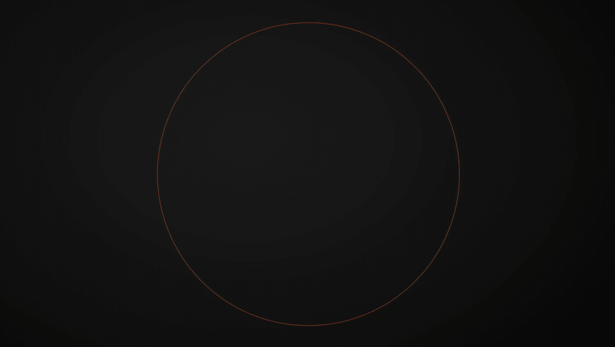
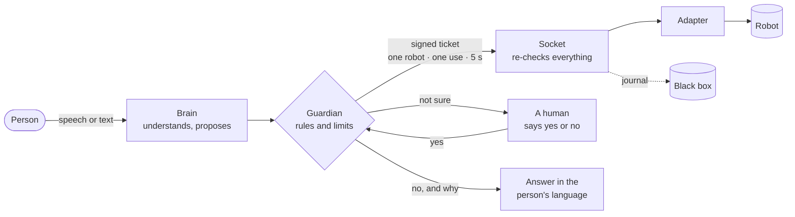
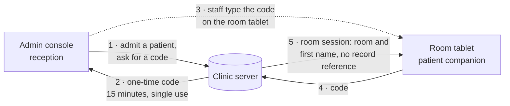
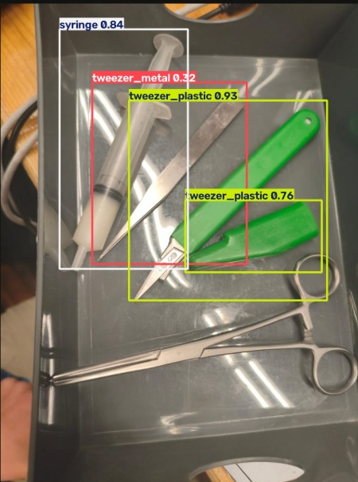

# Care

**A safety layer for care robots: no robot moves without a signed permission, and when the system is not sure, a human decides.**

Built for the Leukerbad Robot Carnival, 14–16 November 2026 · Track: Elderly Care & Rehabilitation

<!-- FILM:START — to get the inline player with sound: edit this file on github.com, drag docs/media/iris-leukerbad-720.mp4
     between these two markers, and delete the teaser block below. -->
<p align="center">
  <a href="docs/media/iris-leukerbad-720.mp4">
    
  </a>
</p>
<p align="center">
  <a href="docs/media/iris-leukerbad-720.mp4"><b>▶ Watch the two-minute film</b></a> (with sound, 9 MB)<br>
  <sub>Concept film · AI-generated images and voice · not a real recording</sub>
</p>
<!-- FILM:END -->

> On the old water channels of Valais, the water turned a small wheel, and the wheel lifted a hammer. As long as it
> knocked, the guard knew, from far away, that the water was flowing. When it fell silent, he went to look.
>
> **Iris is that hammer, for the robots of a small clinic.** A knock: the robot may move. Silence: a human comes to look.

---

## In short

- **One path for every order.** `brain → guardian → socket → adapter`. The guardian signs a single-use ticket or says
  no; the socket refuses anything without a valid ticket. Static tests fail the build if code tries to go around.
- **Robot-agnostic.** Ten actions, the same for every robot. Each robot declares what it can do in a card; what the
  card does not promise is refused.
- **Honest by construction.** Every result is labelled *tested on fake robot* or *tested on real robot*, and
  everything that was not tested is listed in one file.
- **Runs offline.** The robot-side system runs on the team's own computers, with a locally installed language model.

## How an order travels



The details are in [`docs/ARCHITECTURE.md`](docs/ARCHITECTURE.md) and [`docs/SAFETY.md`](docs/SAFETY.md).

## Reception and room tablets

Around the robots, the clinic prototype has two screens for people: an **admin console** for an administrator at the
reception desk, and a **patient companion** on the tablet in each room.



The tablet needs no e-mail address, phone number or password. The medical record reference is kept on the clinic
server and shown only in the admin console; it is never sent to the tablet. All patients are invented. The rules as
the code applies them, what was run and what was only read, and the known limits:
[`docs/PATIENT_ROOM_PAIRING.md`](docs/PATIENT_ROOM_PAIRING.md).

## What is real today

| | Status on 16 November 2026 |
|---|---|
| **Robot hand** (Leadtron DH116) | **Driven by the full system on the real device** (15 Nov): open, hold gently, count, rock-paper-scissors. It refuses "squeeze harder". |
| Robot arm (AgileX PiPER) | Adapter drafted, tested on a stand-in only. At the event the arm replayed its own taught gesture, started by a human. |
| Small walking robot (PrimeBot Q1) | Our tool writes small programs as text; a human pastes them into the robot's own app, and the robot then speaks, gestures and dances. The system sends it nothing. |
| Camera model for medical supplies | Trained by teammates during the event; training code in `models/`. The weights are not in this repository and the model is not wired into the guardian. |
| Small robot head (Reachy Mini) | Adapter written and reviewed, tested on a stand-in only. The real one never moved: six of its nine motors did not answer. |
| Reception, floor delivery, night stock round, therapy game | Planned roles. They run on **simulated** robots. |
| Admin console and room tablets | A room tablet is paired with a one-time code from the admin console. Run in browsers on the team's computers with **invented patients**. On a real tablet: to be verified. Never on a clinic network. |
| Nurses | **None consulted yet.** Every screen about their work is labelled *our guess*. |
| Certification, law | **Nothing is certified.** No specialist has reviewed the project. All patient data is invented. |

The complete list of what has not been tested, line by line: [`NON_TESTE.md`](NON_TESTE.md) (French).

### The camera model on a real photo



A teammates' model for recognising medical supplies (50 classes, training code in [`models/`](models/)) was
fine-tuned during the event. The picture is its output on a **real photo of an instrument tray taken at the event**,
after fine-tuning on a real photo taken the day before.

What the picture shows, read as it is:

- the **syringe** is found (0.84) and the **plastic tweezers** are found (0.93);
- the plastic tweezers are also boxed a second time (0.76), and one low-confidence box is labelled *metal tweezers* (0.32);
- the **surgical clamp** at the bottom of the tray is **not detected**.

This is one image, not an evaluation: no accuracy has been measured on photos the model has not seen. The model is
not connected to the guardian, and its weights are not in this repository.

<br clear="right">

## Run it

Everything below uses fake robots. Nothing here can move a real one.

```bash
./preparer_mac.sh        # first time, on a Mac: checks the machine, asks before installing or downloading anything
python3 lancer.py        # starts the system; open http://localhost:8000
python3 lancer.py tests  # runs the whole test suite
```

Driving a real robot is a separate, deliberate procedure started by a human: [`BRANCHER_UN_ROBOT.md`](BRANCHER_UN_ROBOT.md).

## Verification

- **2,905 Python tests** in the robot-side system. Last full run on the state of this repository:
  2,854 passed, 50 skipped, and **one known timing-sensitive test** (the hand's "wave" gesture, which fails about one
  run in three on a loaded machine; it is marked as such and its cause is written in [`NON_TESTE.md`](NON_TESTE.md)).
  macOS, Python 3.13. There is no continuous integration yet.
- **Tests run with the network cut**: any outbound connection makes a test fail.
- **Tests cannot reach a device**: during a test run the settings are forced to the fake robot.
- **Static anti-bypass tests** read the source code and fail if a robot command is called outside the socket, if an
  adapter is built outside one file, or if anything but the guardian creates tickets
  ([`tests_bout_en_bout/test_aucun_contournement.py`](tests_bout_en_bout/test_aucun_contournement.py)).
- **Real robots need a two-stage conformity test**, without movement first, then one slow movement, each started by a
  human. The system refuses a real robot whose adapter files changed since its test.
- **Independent review**: the adapters of the head and of the hand were read by a reviewer who had not written them.
  What the reviewers found and what was *not* fixed is written down.

These checks show that the rules hold in the code and on simulated robots. They say nothing about a physical robot
beyond the one hand that was tried.

## Repository layout

| Path | What it is | Size |
|---|---|---|
| `briques/` | The robot-side system, one folder per building block: socket and tickets (`b01`), fake robots (`b02`), robot adapters (`b03`), speech (`b04`), vision (`b05`), brain (`b06`), guardian (`b07`), doubt (`b08`), human hand-over (`b11`), black box (`b12`), screens (`b13`), agent door (`b14`), and the clinic scenario (`clinique/`) | Python: 40k lines of code, 30k lines of tests |
| `commun/`, `lancer.py` | Shared code (message bus, languages, settings) and the single entry point | |
| `tests_bout_en_bout/` | End-to-end and anti-bypass tests | |
| `implementation/server/` | The clinic server: fleet, tasks, zones, signed audit journal, emergency mode | Rust: 52k lines of code, 18k lines of tests |
| `implementation/admin/` | The fleet console for the clinic administrator, with a stop button isolated from the rest of the page | TypeScript/React: 11k lines |
| `implementation/patient-web/`, `api/`, `supabase/` | The patient portal prototype and its online back end | JavaScript |
| `models/` | Training code for recognising medical supplies with a camera. The trained weights are not in the repository. | Python |
| `docs/` | [`ARCHITECTURE.md`](docs/ARCHITECTURE.md), [`SAFETY.md`](docs/SAFETY.md), [`PATIENT_ROOM_PAIRING.md`](docs/PATIENT_ROOM_PAIRING.md), and the project's working documents in French (`docs/projet/`) | |

**One difference to know.** The robot-side system is built to run with no Internet. The patient portal is a separate
web prototype that uses online services. The fleet console and the clinic server were developed against simulated
robots and have not been tested with real ones.

## Known limits

- The guardian cannot see people: no person detection is wired to it. That is why it asks a human.
- The robot hand reports motor current, not force; a finger blocked early can be reported as "arrived".
- Voice commands were not measured in a noisy room. Reception does not verify who is speaking.
- The planned clinic roles have only run on simulated robots, and no nurse has been asked whether they help.
- One operating system was used for the robot-side system (macOS). Nothing was tried on a clinic network.

## Languages of this repository

The team works in French and in English, and the repository shows it:

- **In English:** this page, [`docs/ARCHITECTURE.md`](docs/ARCHITECTURE.md), [`docs/SAFETY.md`](docs/SAFETY.md),
  [`docs/PATIENT_ROOM_PAIRING.md`](docs/PATIENT_ROOM_PAIRING.md), [`SECURITY.md`](SECURITY.md),
  [`CONTRIBUTING.md`](CONTRIBUTING.md), and most of the clinic server, admin console and patient companion in
  `implementation/`.
- **In French:** the robot-side system (`briques/`, `commun/`, `lancer.py`, `outils/`, `tests_bout_en_bout/`: names,
  comments and tests), most working documents in `docs/projet/`, and these files at the root: `README.fr.md`,
  `AGENTS.md`, `BRANCHER_UN_ROBOT.md`, `DECISIONS.md`, `LICENCES.md`, `NON_TESTE.md`,
  `PAROLES_DES_SOIGNANTS.modele.md`. Writing in French with simple words is one of the project's written rules.

A [French–English glossary](docs/ARCHITECTURE.md#frenchenglish-glossary) gives the English word for the main French
names used in the code.

## How this was built

The robot-side frame existed before the event; the team says so plainly. During the weekend it gained the adapters
for the hand, the head and the arm, the tool for the walking robot, Spanish at reception, and the fixes found
by the reviews. Much of the code was written with AI coding agents working under written rules
([`AGENTS.md`](AGENTS.md), [`docs/projet/REGLES_DES_AGENTS.md`](docs/projet/REGLES_DES_AGENTS.md)): small steps, tests
before "done", never present simulated results as real, and a different reviewer than the author.

The presentation film is a **concept film** made with AI image, video and voice models; it says so on every frame.
In the film Iris has a body; in reality she is software. The tall wheeled robot shown in the film was never driven by
this system.

## More to read

- [`README.fr.md`](README.fr.md) — the full description of the project, in French
- [`DECISIONS.md`](DECISIONS.md) — the design decisions and why
- [`implementation/architecture.md`](implementation/architecture.md) — the server, console and portal
- [`docs/PATIENT_ROOM_PAIRING.md`](docs/PATIENT_ROOM_PAIRING.md) — how reception links a tablet to a patient's room
- [`LICENCES.md`](LICENCES.md) — every third-party component and its licence
- [`SECURITY.md`](SECURITY.md) — how to report a problem

## Licence

[MIT](LICENSE) for the code written by the team. Third-party components, the speech samples in `donnees_voix/` and
the mascot image keep their own licences and conditions, listed in [`LICENCES.md`](LICENCES.md). The camera-recognition
code in `models/` relies on a library distributed under AGPL-3.0: using it brings that licence's obligations.

## Team

Choaib, Jad, Alexandre, Hiba (project lead) and Adeline.
