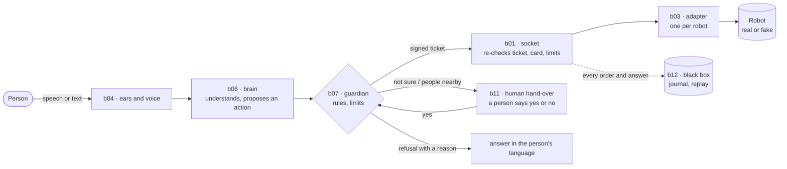

# Architecture

This document describes the robot-side system (`briques/`, `commun/`, `lancer.py`). The clinic server, the fleet
console and the patient portal have their own description in [`implementation/architecture.md`](../implementation/architecture.md).

## One path for every order

Every request that could make a robot act follows the same four steps. There is no second path, and a test suite
fails the build if someone adds one (see [SAFETY.md](SAFETY.md#what-the-tests-enforce)).



| Step | Module | Responsibility | It never… |
|---|---|---|---|
| Understand | `briques/b06_cerveau` | Turns a sentence into one of ten actions, or says it did not understand. A local language model (Apertus 8B, then 4B) with a rule-based fallback. | …talks to the socket or the guardian directly. It only proposes. |
| Decide | `briques/b07_gardien` | Applies the safety rules to the proposed action. Issues a signed, single-use ticket, asks a human, or refuses with a reason. | …moves anything. |
| Enforce | `briques/b01_prise` | Refuses any action without a valid ticket; works on its own copy of the action; re-checks the robot's card and the global ceilings; owns the emergency stop. | …trusts the caller. |
| Act | `briques/b03_adaptateurs` | Translates the ten actions into one robot's own commands. One folder per robot. | …is created anywhere but in `commun/systeme.py`. |

## The ten actions

The socket accepts exactly ten actions, the same for every robot. A robot's *card* (a YAML file) states which ones it
can do and its limits; what the card does not promise is refused.

`se_deplacer` (move) · `regarder` (look) · `ecouter` (listen) · `parler` (speak) · `saisir` (grasp) · `poser` (put down) ·
`montrer` (point) · `rejouer_geste` (replay a named gesture) · `arreter` (stop — always allowed) · `etat` (report state)

The list lives in `briques/b01_prise/actions.py` and is documented in [`PRISE.md`](../briques/b01_prise/PRISE.md);
a test checks that the code and the document agree. Emergency stop and re-arming are commands of the socket, not actions:
they need no ticket.

## The modules

| Module | What it is |
|---|---|
| `b01_prise` | The socket: actions, robot cards, tickets, validation, emergency stop |
| `b02_faux_robot` | Fake robots (humanoid, dog, arm, wheeled base) that behave like real ones, including failures |
| `b03_adaptateurs` | Robot adapters, an assistant that scaffolds a new one, and a two-stage conformity test |
| `b04_oreilles_voix` | Speech recognition, voice activity detection, speech synthesis |
| `b05_yeux` | Camera, markers, calibration; plug-in interface for detectors |
| `b06_cerveau` | The brain: model cascade with a rule-based fallback, and a measured benchmark |
| `b07_gardien` | The guardian: rules in `regles.yaml`, verdicts, tickets |
| `b08_doute` | "I am not sure": vague requests, what was learned from human help |
| `b11_main_humaine` | Human hand-over: the robot raises its hand and waits for a person |
| `b12_boite_noire` | Black box: journal of every order and answer, replay, truth sheet |
| `b13_ecran` | Web screens served to the team's phones and laptops (FastAPI), including the stop button |
| `b14_porte_agents` | A door for software agents (MCP) that goes through the same guardian |
| `b15_chef_demo` | Demo conductor: scripted rehearsals with injected failures |
| `b17_kit_samedi` | A kit that turns the challenge text into a 48-hour plan |
| `clinique/` | The clinic scenario: reception, care checklists, role cards, fleet dispatch, summaries with sources |
| `commun/` | Message bus, languages, settings, the chain that wires everything |

## Adding a robot

A robot is one folder in `briques/b03_adaptateurs/robots/<name>/`:

```
carte.yaml      what the robot can do, with every limit and where the number was read
liaison.py      the only file that talks to the manufacturer's kit
doublure.py     a stand-in for that kit, for tests
adaptateur.py   maps the ten actions onto the liaison
tests/
```

The assistant creates the folder from an empty template (`python3 lancer.py brancher <name> --genre … --chemin …`).
A conformity test then checks that the adapter respects the socket contract. On a real robot it runs in two stages,
each started by a human who types a random confirmation phrase: first **without movement**, then **one slow movement**.
The system refuses to drive a real robot whose test has not passed, or whose `carte.yaml`, `liaison.py` or
`adaptateur.py` has changed since (their fingerprints are stored with the result).

Robots present in this repository:

| Folder | Robot | Tested on |
|---|---|---|
| `leadtron_dh116` | Robot hand, six motors | **Real device** (15 Nov 2026) and stand-in |
| `agilex_piper` | Six-axis arm | Stand-in only |
| `reachy_mini` | Small robot head | Stand-in only |
| `unitree_go2`, `roues_ros2`, `roues_deux_bras` | Quadruped, ROS 2 wheeled base, two-armed wheeled robot | Drafts, stand-in only |

## Settings and offline operation

`reglages.yaml` is local to each computer and never committed; `reglages.exemple.yaml` is the template. The robot-side
system is designed to run with no Internet: the language model, the speech models and the screens are served from the
team's own machines. Tests run with network access disabled for the program.

## French–English glossary

The robot-side system is written in French (see [why](../README.md#languages-of-this-repository)). These are the names
a reader meets in the code and in the commands.

| French name | English | Where it appears |
|---|---|---|
| `briques` | building blocks (the modules) | top-level folder |
| `prise` | socket: the single entry point to a robot | `b01_prise` |
| `ticket` | signed, single-use permission | `b01_prise/ticket.py` |
| `carte` | a robot's card: what it can do, and its limits | `carte.yaml` |
| `faux robot` / `vrai robot` | fake (simulated) robot / real robot | `b02_faux_robot`, labels on every result |
| `adaptateur` | adapter: translates the ten actions for one robot | `b03_adaptateurs`, `adaptateur.py` |
| `liaison` | link: the only file that talks to a manufacturer's kit | `liaison.py` |
| `doublure` | stand-in for a manufacturer's kit, used by tests | `doublure.py` |
| `conformité` | conformity test of an adapter | `lancer.py brancher … --conformite` |
| `fiche` | data sheet of a robot, with sources | `b03_adaptateurs/fiches/` |
| `oreilles`, `voix` | ears (speech recognition), voice (speech synthesis) | `b04_oreilles_voix` |
| `yeux` | eyes (camera) | `b05_yeux` |
| `cerveau` | brain: understands a sentence and proposes an action | `b06_cerveau` |
| `gardien` | guardian: decides, and signs tickets | `b07_gardien` |
| `règles` | rules of the guardian | `regles.yaml` |
| `doute` | doubt: "I am not sure" | `b08_doute` |
| `main humaine` | human hand: hand-over to a person | `b11_main_humaine` |
| `boîte noire` | black box: journal and replay | `b12_boite_noire` |
| `écran` | screen: the web pages | `b13_ecran` |
| `porte des agents` | agents' door: access for software agents | `b14_porte_agents` |
| `chef de démo` | demo conductor | `b15_chef_demo` |
| `clinique` | clinic: the care scenario | `briques/clinique` |
| `commun` | shared code | `commun/` |
| `geste` | gesture (a named, recorded movement) | `rejouer_geste`, `gestes.yaml` |
| `arrêt d'urgence` | emergency stop | `arret_urgence` |
| `réarmer` | re-arm after an emergency stop | `rearmer` |
| `signe de vie` | sign of life (heartbeat for the watchdog) | `signe_de_vie` |
| `réglages` | settings | `reglages.yaml`, `reglages.exemple.yaml` |
| `lancer` | to launch: the entry point | `lancer.py` |
| `brancher` | to plug in (connect) a robot | `lancer.py brancher` |
| `outils` | tools (helper scripts) | `outils/` |
| `tests de bout en bout` | end-to-end tests | `tests_bout_en_bout/` |
| `non testé` | not tested: the list of what was not tried | `NON_TESTE.md` |

The ten actions are translated [above](#the-ten-actions).

## What sits outside this design

- The clinic server, the fleet console and the patient portal (`implementation/`, `api/`, `supabase/`) are separate
  programs. The console *asks*; the server decides; each robot keeps the final say through the path above.
  The patient portal prototype uses online services. How reception links a room tablet to a patient is described in
  [`PATIENT_ROOM_PAIRING.md`](PATIENT_ROOM_PAIRING.md).
- The medical-supply recognition model (`models/`) is training code and is not wired into the guardian.
