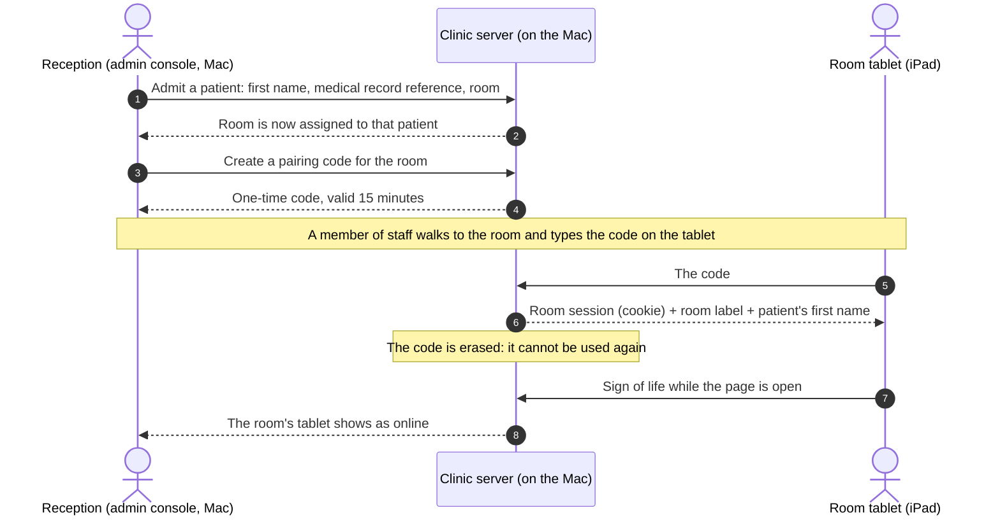

# Reception and room tablets: how a tablet joins a room

The clinic prototype has two screens for people, on purpose separate:

| Screen | Who uses it | Where it runs in the demo | Code |
|---|---|---|---|
| **Care · Hospital operations console** (the admin console) | Reception and the care team | A Mac that plays the hospital reception desk | [`implementation/admin/`](../implementation/admin/) |
| **Care · Patient companion** | The patient, on the tablet of their room | An iPad in the room | [`implementation/patient-web/`](../implementation/patient-web/) |

Both talk to the clinic server ([`implementation/server/`](../implementation/server/), Rust), which runs on the
reception Mac. A room tablet never asks the patient for an e-mail address, a phone number or a password: it is
linked to a **room**, once, with a short code that a member of staff types.

Everything here was run with **invented patients** on the team's own computers. It has not been tried in a clinic
or on a clinic network.

## The flow



1. In the admin console, page **Patients**, panel *Admit a patient*: the administrator enters a **first name**, a
   **medical record reference** and picks a free **room**.
2. The server assigns the patient to that room (one patient per room).
3. In the panel *Tablet pairing*, the administrator selects the room. The server answers with a **one-time pairing
   code**.
4. The administrator types the code on the tablet in that room.
5. The tablet is now the tablet of that room. The patient companion greets the patient by first name and shows the
   content of their stay.
6. The console lists the room's tablet as **online** while the tablet keeps giving a sign of life.

## The rules, as the code applies them

| Rule | Value | Where to read it |
|---|---|---|
| A pairing code is valid for | **15 minutes** | `PAIRING_MILLIS` in [`server/src/patient/rooms.rs`](../implementation/server/src/patient/rooms.rs) |
| A pairing code can be used | **once**: the server erases it when a tablet uses it | `pair` in the same file |
| Form of the code | 12 characters, digits and the letters A–F | `create_device` in the same file |
| Comparing the typed code with the stored one | In constant time (the time taken does not reveal how many characters were right) | `pair` |
| What the tablet keeps | A session cookie that page scripts cannot read (`HttpOnly`) | `room_cookie` |
| A tablet session lasts | **30 days**, unless it is ended earlier | `ROOM_SESSION_SECONDS` |
| A tablet session ends when | staff unpair it, a new code is used for that room, or **the patient is discharged** (the tablet is revoked) | `unpair`, `discharge` |
| A tablet counts as online | if it was seen in the last 2 minutes | `ONLINE_MILLIS` |
| Who may admit, pair and discharge | Only a signed-in member of staff with the **admin** role | `require_admin` |

### What the tablet receives, and what it does not

- **Sent to the tablet:** the room (label, wing, floor), the tablet's own label, the patient's **first name**, the
  patient's status (*admitted*) and an internal random identifier used to fetch that patient's requests, questions
  and daily programme.
- **Never sent to the tablet:** the **medical record reference**. It is returned only by the admin routes, to a
  signed-in administrator.
- The pairing code is shown in the admin console only. The console does not keep it in the browser's storage.

A test walks through the whole flow on the server (admit, create a code, pair, read the room session):
`a_room_tablet_pairs_and_uses_the_day` in
[`implementation/server/tests/patient_api.rs`](../implementation/server/tests/patient_api.rs).

## What the demo set-up needs

- The Mac and the iPad are on the **same Wi-Fi network**.
- The clinic server stays running on the Mac.
- The iPad opens the patient companion at the Mac's address on the local network:

  ```text
  https://<address-of-the-mac>:8443/patient/
  ```

  The server prints the exact address when it starts. It uses a certificate it made itself, so the tablet shows a
  warning that has to be accepted once. Step by step: [`implementation/PITCH_RUNBOOK.md`](../implementation/PITCH_RUNBOOK.md).
- In the demo there are three rooms, each with one tablet: **212, 213 and 216**.

## Limits to know

- **Invented data only.** No real patient, no real medical record reference.
- The server's patient store is a prototype: one file on the reception computer (`data/patients.json`), written
  in clear text, pairing codes included while they are valid. It is not a medical records system.
- The certificate is self-made; a real deployment needs a proper one, issued for the clinic's network.
- Whoever holds a valid code and reaches the server within 15 minutes can pair a tablet with that room. The code is
  meant to be carried by a member of staff, not shown to visitors.
- Whether repeated wrong codes are slowed down enough has **not been tested** by us.
- The same flow also exists for the online prototype of the patient portal (`api/`, `supabase/`), which uses online
  services. The two back ends were written to behave the same way; we did not compare them route by route.
- Nothing here has been reviewed by a security specialist, a clinician or a lawyer.
