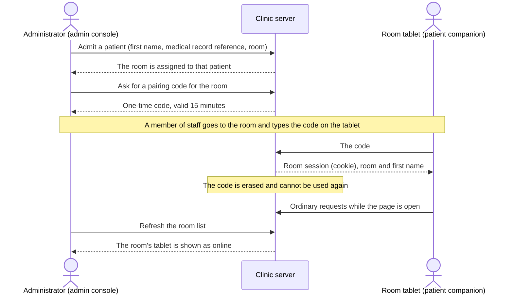

# Reception and room tablets: how a tablet joins a room

The clinic prototype has two screens for people, deliberately separate:

| Screen | Who uses it | Code |
|---|---|---|
| **Care · Hospital operations console** (the admin console) | An administrator, at the reception desk | [`implementation/admin/`](../implementation/admin/) |
| **Care · Patient companion** | The patient, on the tablet in their room | [`implementation/patient-web/`](../implementation/patient-web/) |

Both talk to the clinic server ([`implementation/server/`](../implementation/server/), Rust). A room tablet never asks
the patient for an e-mail address, a phone number or a password: it is linked to a **room**, once per stay, with a
short code that a member of staff types.

**Every rule on this page is read from the code of the Rust server**, with the file where it can be checked.
What was actually run, and what was only read, is said in [What was run](#what-was-run-and-what-was-only-read).
All patients are invented.

## The flow



1. In the admin console, page **Patients & rooms**, panel *Admit a patient*: the administrator enters a **first
   name**, a **medical record reference** and picks a free **room**. The server accepts one patient per room.
2. Right after the admission, if the room has no paired tablet, the console asks the server for a **one-time pairing
   code** and shows it in the panel *Tablet pairing*. A new code can be asked for with the button on the room's card.
3. A member of staff opens the patient companion on the tablet, chooses **Room tablet** and types the code.
4. The tablet is now the tablet of that room. The patient companion greets the patient by first name.
5. The console lists the room's tablet as **online** when one of the tablet's requests reached the server in the
   last two minutes.

## The rules, as the code applies them

All in [`implementation/server/src/patient/rooms.rs`](../implementation/server/src/patient/rooms.rs).

| Rule | Value | Where to read it |
|---|---|---|
| A pairing code is valid for | **15 minutes** | `PAIRING_MILLIS` |
| A pairing code can be used | **once**: the server erases it in the same step that opens the session | `pair` |
| Form of the code | 12 characters, digits and the letters A–F | `create_device` |
| Comparing the typed code with the stored one | With a comparison written not to stop at the first wrong character (not measured) | `pair` |
| What the tablet keeps | A session cookie that page scripts cannot read (`HttpOnly`, `SameSite=Strict`) | `room_cookie` |
| A tablet session lasts | at most **30 days** | `ROOM_SESSION_SECONDS` |
| A tablet session ends earlier when | someone presses *Disconnect this tablet* on the tablet itself (no staff sign-in is asked), or **the patient is discharged** (the tablet is revoked) | `unpair`, `discharge` |
| A new code for a room that already has a tablet | Creating it does not end the current session. When a tablet uses it, the session is replaced and the previous tablet is refused at its next request | `create_device`, `pair` |
| A tablet counts as online | if one of its requests reached the server in the last 2 minutes (the page asks every 15 seconds). The console shows the state as of its last refresh | `ONLINE_MILLIS` |
| Who may admit, create a pairing code and discharge | An account with the **admin** role only. The other staff roles (reception, nurse, doctor, therapist) are refused | `require_admin` |
| Typing the code on the tablet | Needs no sign-in: holding a valid code is enough | `pair` |

### What the tablet receives, and what it does not

- **Sent to the tablet:** the room (identifier, label, wing, floor), the tablet's own identifier and label, the
  patient's **first name**, the patient's status (*admitted*) and a random patient identifier. The tablet does not
  send that identifier back: the server finds the patient from the cookie.
- **Never sent to the tablet:** the **medical record reference**. It is kept on the clinic server and returned only
  by the admin routes, to a signed-in administrator. No route that accepts the tablet's cookie returns it.
- The console keeps the pairing code in memory only (it is gone when the page is reloaded), not in the browser's
  storage. Its *Copy code* button puts the code on the clipboard.

## What was run, and what was only read

- **Run, with invented patients:** admit, create a code, pair, read the room session, use the patient pages,
  disconnect. A server test covers these steps (`a_room_tablet_pairs_and_uses_the_day` in
  [`implementation/server/tests/patient_api.rs`](../implementation/server/tests/patient_api.rs)), and a browser script
  also checks that a wrong code and a code used twice are refused
  ([`implementation/admin/e2e/pitch-patient.mjs`](../implementation/admin/e2e/pitch-patient.mjs)), in a desktop browser
  with a tablet-sized window.
- **Read in the code, not timed or tested:** the 15-minute expiry, the 30-day limit, the two-minute online rule,
  the revocation at discharge, and the replacement of a session by a new code.
- **On a real tablet:** the team's set-up for the pitch is a Mac that plays the reception desk, running the server,
  and an iPad in the room, both on the same Wi-Fi network. The repository's runbook, written earlier, says the
  patient pages were *not tried on real phone hardware or iPad Safari*. Nothing in the repository records a run on a
  real iPad: **to be verified with the team**.
- **Never** run in a clinic or on a clinic network.

## What the set-up needs

- The computer that runs the server and the tablet are on the **same Wi-Fi network**, and the server stays running.
- The tablet opens the patient companion at the server's address on the local network:

  ```text
  https://<address-of-the-server>:8443/patient/
  ```

  When the server starts with https, its log prints the address on a line that begins with `Phones:`. The certificate
  is self-signed, so the tablet shows a warning that has to be accepted once.
- The runbook ([`implementation/PITCH_RUNBOOK.md`](../implementation/PITCH_RUNBOOK.md)) currently gives the room tablet
  a plain-http address with the code in it (`http://<address>:8080/patient/login.html?code=…`). That works, but the
  link is not encrypted and the code stays in the browser's history.
- **Rooms.** The Rust server takes its rooms from the clinic map (Room 11 to Room 14 in the seed map). The online
  prototype has three fixed rooms: **212, 213 and 216**.

## Known limits

- **Invented data only.** No real patient, no real medical record reference.
- **The patient store is a prototype**: one JSON file under the server's working directory (`data/patients.json`),
  in clear text. It holds the medical record references, the tablet session tokens (valid 30 days) and the pairing
  codes until they are used, replaced, or the patient is discharged (an expired code stays in the file but is
  refused). It is not a medical records system.
- **Wrong codes are not counted.** `pair` has no limit on wrong attempts. The only brake is the server's general
  limit per address, which was raised for the pitch (100 requests per second).
- **The session cookie is not marked `Secure`** when the tablet talks to the server directly, and the same server
  also answers in plain http on port 8080.
- For the pitch, several of the server's checks are relaxed: the same-origin check on the patient routes, the list
  of allowed origins and the known-network check. The runbook lists them in its table *Relaxed for the pitch*.
- A code can be created and used for a room with no patient; such a tablet is not revoked by a discharge.
- The day programme shown on the tablet is the same fixed demonstration list for every room.
- The certificate is self-signed; a real deployment needs a proper one, issued for the clinic's network.
- **The online prototype differs.** The same flow exists for the online patient portal (`api/`, `supabase/`), but
  not with the same rules: it stores a hash of the code and of the session token instead of clear text, it refuses a
  new code for a room that already has a paired tablet, and its rooms are the three fixed ones. We did not compare
  the two back ends route by route.
- Nothing here has been reviewed by a security specialist, a clinician or a lawyer.
